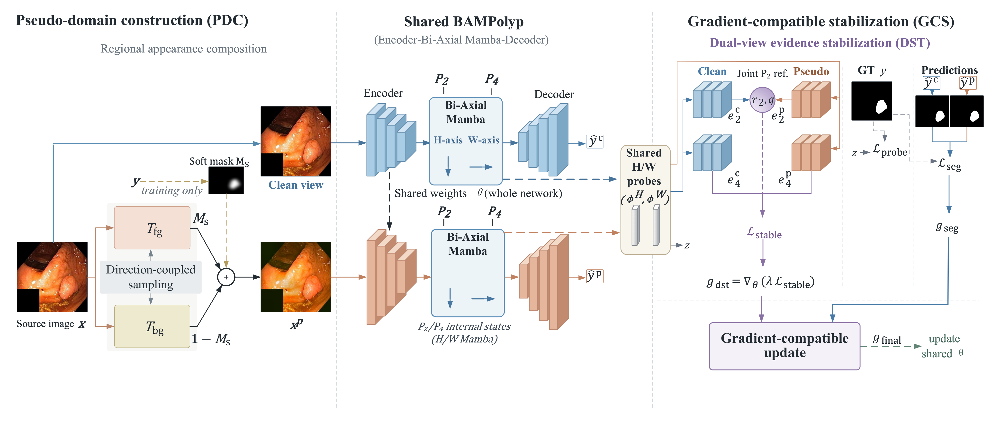

# DiRaGS for Single-Source Polyp Segmentation

DiRaGS (Direction-Coupled Regional Augmentation with Gradient-Compatible
Stabilization) combines PDC regional pseudo-domain construction with a DST
evidence-preservation objective and gradient-compatible auxiliary updates.
The auxiliary components are used during training; inference uses the original
segmentation network.

This edition provides **training and four-domain evaluation of the complete
DiRaGS model**, plus **PDC cross-backbone experiments on PraNet and MRANet**.
The full-model experiment ID `D_pdc_gcs` is retained for checkpoint compatibility.



## Quick start: train and evaluate DiRaGS

Run commands from this repository root using Bash on Linux. The Python package
is `dirags`; setup variables use the `DIRAGS_` prefix. The recorded training stack
uses Python 3.10.18 and CUDA 11.3.

```bash
python -m venv .venv
source .venv/bin/activate
python -m pip install -r requirements.txt
python -m pip check
```

See [installation](docs/installation.md) for environment details.

### Obtain the backbone and datasets

Follow [external backbone setup](docs/external_backbones.md) to obtain the
pinned main model source separately and configure:

```bash
export DIRAGS_MAIN_SOURCE=/path/to/upstream/BAMPolyp/bampolyp.py
python scripts/check_external_backbones.py --backbone main
```

Prepare Kvasir-SEG and the four target datasets using the provider links and
directory tree in [data preparation](docs/data.md). Set `DATA_ROOT` to the
directory containing `Kvasir-SEG`, `CVC-ClinicDB`, `CVC-ColonDB`,
`ETIS-LaribPolypDB` and `PolypGen`. Retain the supplied filenames and the
bundled fixed source and target manifests.

```bash
DATA_ROOT=/path/to/datasets
python train.py --config configs/dirags_seed42.json --validate-only
python evaluate_ood.py --config configs/dirags_seed42.json --validate-only
```

### Train the complete model

```bash
python train.py --config configs/dirags_seed42.json --data-root "$DATA_ROOT/Kvasir-SEG" --output-dir runs/dirags_seed42 --device cuda:0
```

Training uses the fixed 800/100/100 source split, seed42 and 300 epochs. Checkpoint
selection uses source-validation IoU. ImageNet encoder initialization is enabled
by default and is downloaded by torchvision when it is not cached. Keep the
complete output directory with `best_model.pth`, `last_checkpoint.pth`,
`history.csv`, `metrics.json`, all configuration/split snapshots and environment
metadata. Training `metrics.json` contains source-domain results.

For epoch-boundary continuation:

```bash
python train.py --config configs/dirags_seed42.json --data-root "$DATA_ROOT/Kvasir-SEG" --output-dir runs/dirags_seed42 --resume runs/dirags_seed42/last_checkpoint.pth --device cuda:0
```

Fresh runs require a new output directory. Resume verifies configuration, split
and initialization settings against the saved run.

### Evaluate on four target domains

```bash
python evaluate_ood.py --config configs/dirags_seed42.json --checkpoint runs/dirags_seed42/best_model.pth --clinicdb "$DATA_ROOT/CVC-ClinicDB" --colondb "$DATA_ROOT/CVC-ColonDB" --etis "$DATA_ROOT/ETIS-LaribPolypDB" --polypgen "$DATA_ROOT/PolypGen" --output-dir runs/dirags_ood4 --device cuda:0
```

Outputs are `per_image.csv`, `metrics.json`, `manifest.json`,
`config_snapshot.json` and `environment.json`. The evaluator verifies the
completed source-training run and its selected checkpoint. Keep the checkpoint
with its training metadata; `--run-dir` supports separately located metadata.

The target manifest contains ClinicDB 612, ColonDB 380, ETIS 196 and PolypGen
273 images. The 211 positive PolypGen masks enter overlap means; the 62 empty
masks remain separate. Scoring retains RGB/ImageNet image preprocessing,
PIL bilinear images, PIL nearest masks, GT >=128, argmax predictions and the
256x256 grid. Macro scores equally weight the four positive-frame domain means.
The standard evaluator retains its original negative-frame statistics.

Read `aggregate.target_mean.dice` and `aggregate.target_mean.iou` from OOD4
`metrics.json` and multiply by 100. 

Compare the four-domain evaluation results with the DiRaGS row in Table 2 of the paper.

Unrounded reference values and checkpoint identities are in
[`results/dirags_seed42_reference.json`](results/dirags_seed42_reference.json).
New training runs can vary across hardware/software environments. During
method development, target results were used to compare pseudo-domain
construction strategies; parameter updates and per-run checkpoint selection
used source data.

## PDC cross-backbone experiments

The two cross-backbone groups compare each backbone's baseline and PDC paired
training. They use the shared PDC implementation without DST/GCS. Initialization,
input preprocessing, losses and training budgets retain their formal settings.

| Group | Configurations | Training | Evaluation |
|---|---|---|---|
| PraNet (`backbone_1`) | `configs/cross_backbone/backbone_1_*_seed42.json` | `scripts/train_backbone_1.py` | `scripts/evaluate_backbone_1.py` |
| MRANet (`backbone_2`) | `configs/cross_backbone/backbone_2_*_seed42.json` | `scripts/train_backbone_2.py` | `scripts/evaluate_backbone_2.py` |

Use the baseline and PDC configuration separately. Complete commands,
initialization downloads, preprocessing and archived results are in
[cross-backbone experiments](docs/cross_backbone.md).

## Files

```text
train.py / evaluate_ood.py     Complete DiRaGS workflow
configs/dirags_seed42.json     Full-model scientific configuration
configs/cross_backbone/        Two backbone baseline/PDC pairs
src/dirags/methods/            PDC, DST and GCS
src/dirags/training/           Full-model training and checkpoint helpers
src/dirags/cross_backbone/     PDC transfer training and inference
src/dirags/evaluation/         Shared scoring and checkpoint validation
src/dirags/integrations/       External model/loss interfaces
splits/                       Fixed source/target manifests
results/                      Full-model and cross-backbone references
docs/                         Installation, sources and data preparation
assets/                       Framework figure
```

## Sources and weights

The main backbone is BAMPolyp. `backbone_1` is PraNet and `backbone_2` is MRANet.
Obtain their pinned model/component-loss sources, datasets and initialization
weights separately using the linked guides. Selected paper checkpoints are
not distributed in this package; train the desired configuration before
evaluation. JSON reference files contain metrics and identities, not weights.

[Third-party notices](THIRD_PARTY_NOTICES.md) record source attribution,
reproduction adaptations and upstream terms. The source-symbol/hash mapping is
in [`provenance/upstream_sources.json`](provenance/upstream_sources.json).
Historical protocol tags, configuration IDs and checkpoint parameter keys are
retained for reproducibility. The framework figure is unchanged from the
manuscript. Publication information will be added with the public paper.
